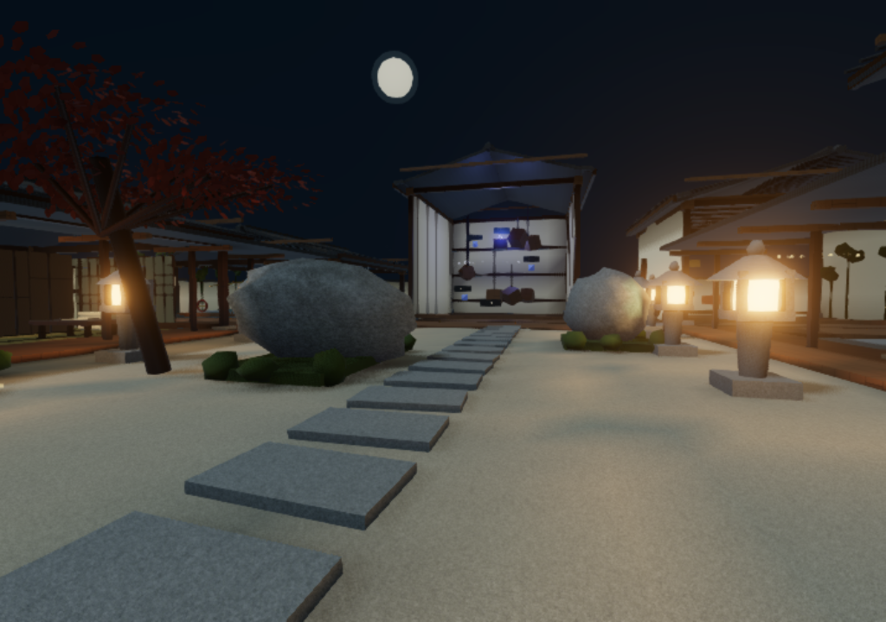

# 朧の屋敷 — OBORO

TenTenV公式テンプレートを基にした、1〜4人の協力型忍者屋敷脱出ワールドです。五つの印を集め、忍者の気配をかわし、南の門から脱出します。一人でも解けます。難易度3段階、共有鍵・仕掛け・勝敗、得点、途中参加、ホスト引き継ぎ、再挑戦を実装しています。



[ブラウザで遊ぶ](https://xenoah.github.io/tentenvworld_oboro-yashiki/) · [配布物とリリース](https://github.com/Xenoah/tentenvworld_oboro-yashiki/releases)

Pagesデモはソロと同一ブラウザ内の最大4タブ協力に対応します。別端末同士のオンライン協力・VCには親サーバーが必要です。WebGL 2を利用できるブラウザで開いてください。公開バージョンのSHAは `build.json`、CI結果はGitHub Actionsで確認できます。[Pages導入と検証手順](docs/PAGES.md)を参照してください。

## v1.2 の移動と足音

Shiftでダッシュ、Spaceで跳躍。下降中、地面まで約75cmでXか画面ボタンを一度押すと静音着地。早押し・押し忘れの足音は忍者の捜索につながります。砂地だけに砂埃が立ち、「映像」でダッシュ／ジャンプのブラーを調整（0でOFF）できます。XR・携帯端末・低解像度ではブラーOFF。音のミュートは忍者の聴覚に影響しません。[操作・判定・同期・検証範囲](docs/MOVEMENT.md)。

## v1.1 からの映像設定

画面下の「映像」で柔らかな光を標準／軽量／切に変更し、にじみの強度を調整できます。木・漆・瓦・真鍮の反射、月夜の反射環境、建築の局所AOと静的灯籠の拡散光ベイクを追加しました。携帯端末・低解像度では軽量表示、XRではにじみOFFです。

ベイクは実メッシュへの光線計算を保存した**頂点AO＋静的な直接拡散光**です。多重反射GIやシーン全体のライトマップではありません。`npm run bake` で再生成し、`npm run check:bake` で形状と保存データの一致を検査できます。[生成手順・比較画像・限界](docs/LIGHTING.md)。

## 最短で起動

Node.js **22.13以上（24推奨）** と現在のChrome/Chromium/Edgeを用意します。

```sh
npm ci
npm run dev
```

表示されたURLを開きます。

**http://localhost:5190/?devWorld=http%3A%2F%2Flocalhost%3A5180%2F**

同じブラウザ・同じプロファイルでこのURLを4タブまで開くと、公式の開発用BroadcastChannelで共同探索できます。ログイン・親サーバー・資格情報は不要です。画面の `Server offline / DEV` は、この公式ローカル開発モードでは正常です。別の端末同士はこの方式では接続できません。

このワークスペースのようにホームディレクトリが読み取り専用の場合は、`npm ci --cache /tmp/oboro-npm-cache` を使えます。依存のロックと整合性検証は維持します。

## 遊び方

- 主催者が玄関で難易度を選び「探索を始める」。他の参加者は途中から加わっても同じ鍵・時間・扉を受け取ります。
- WASD移動、マウス視点、クリックまたはEで調べる。初めに3D画面をクリックして視点をロックします。Escでカーソルを戻す（公式メニューも開くので、Rで閉じられます）。
- 水中・無重力では、向いた方向へWASD、Space上昇、Qまたは左Ctrl下降。
- VRではレイ＋トリガーで仕掛けを押し、スティックで移動。上を向いて前進すると泳ぎ・浮遊の上昇ができ、右トリガーでも上昇できます。
- 「快適移動」は初期ON。跳躍・浮遊のワープ足場と水平視点を使います。OFFでは跳躍の速度を与え、desktopの壁/天井で視点の向きも切り替わります。VRはOFFでも視点をrollさせません。
- 手引きは画面右下、VRでは玄関と各区画の看板。困ったら「玄関へ帰還」で安全地点へ（減点）。忍者は中庭だけを巡回し、構えの予兆後に捕縛します。
- 五つの印を取ったら玄関南側の門で「五印を納め、脱出」。捕縛・時間切れでは全員敗北。終了後は主催者が再挑戦できます。

解法・得点式・通信設計は [docs/ARCHITECTURE.md](docs/ARCHITECTURE.md) に記載しています。

## 配布用ビルドと実行

```sh
npm run typecheck
npm test
npm run build:all
npm start
```

`npm start` は、ビルドされた公式クライアントと **releases/oboro-yashiki.ttvw そのもの** を localhost:5190 / 5180 に配信します。同じ起動URLを使います。開発サーバーを起動済みの場合はCtrl+Cで止めてから実行してください。

個別のコマンド:

```sh
npm run build          # 公式 ttv-world build、静的検査も実施
npm run pack           # releases/oboro-yashiki.ttvw
npm run build:client   # 同梱クライアントの本番ビルド
npm run test:e2e       # dev起動中に /usr/bin/chromium で実行
```

別のChromium実行ファイルは `BROWSER=/path/to/chromium npm run test:e2e` で指定できます。テストは独立したブラウザコンテキストを作ります。

## TenTenV親サーバーへ導入

1. 利用するTenTenV親サーバーで自分のアカウントにログインします。
2. 公式クライアントの「制作」から `releases/oboro-yashiki.ttvw` を登録します。
3. 最大人数4のインスタンスを作り、招待リンクを共有します。
4. 本物の局所重力・泳ぎ・壁天井の移動を使う参加者には、本プロジェクトのクライアントを使います。**ワールドファイルだけで標準クライアントの移動処理を書き換えるものではありません。**

SDK 0.1.1に局所重力APIがないため、この独立コピーにoptional locomotion APIを実装しています。標準クライアントではワープ足場による互換経路になる設計です（標準能力相当のfixtureで一周確認、未改変の別クライアントでの通し試験は未実施）。固定upstreamへ適用可能な差分は `patches/oboro-client.patch` に保存しています。[公式クライアント拡張の適用コマンドと検証範囲](docs/CLIENT_EXTENSION.md) を参照してください。第三者のリポジトリへpush/PRはしていません。

本配布物は親サーバーを同梱せず、既存のサーバー運営設定や認証方式を変更しません。端末間のWebRTC/TURN・音声・実際の親サーバー経由の試験は未実施です。VRは実機未検証です。細かなアバター全身の壁面姿勢には制限があります。検証の範囲と測定値は [docs/VALIDATION.md](docs/VALIDATION.md) を参照してください。

## 構成とライセンス

- `worlds/oboro/`: 公式テンプレート形式のワールド本体、画像、音
- `packages/sdk`, `packages/protocol`: 固定版の公式ソース（SDKにはoptional型を追加）
- `apps/client`: 固定版の公式クライアント＋局所移動・開発通信の差分
- `tests/`: 状態機械テストと実ブラウザ試験
- `scripts/generate-materials.py`: 自作画像マップ・音の再生成（Pillow/NumPy。通常起動時は不要）
- `evidence/`: 実画面、試験結果
- `docs/RESEARCH.md`: 実際に確認したSDK機能・制限・実装計画

公式固定版: [KinuX2/TenTenV](https://github.com/KinuX2/TenTenV), commit `97e9bc120f4f977e0a3cfdb79379391e236f25e2`。SDKはnpm未公開のためソース同梱です。本プロジェクトはAGPL-3.0-only、無保証。配布する場合は対応するソースコードとLICENSEも一緒に提供してください。素材の来歴は [docs/ASSETS.md](docs/ASSETS.md)、継承した依存の帰属は [docs/THIRD_PARTY.md](docs/THIRD_PARTY.md) を参照。

既存のmeshcopia作品・リポジトリは作業基盤として参照しただけで変更していません。本プロジェクトは別ディレクトリの独立Gitリポジトリです。
