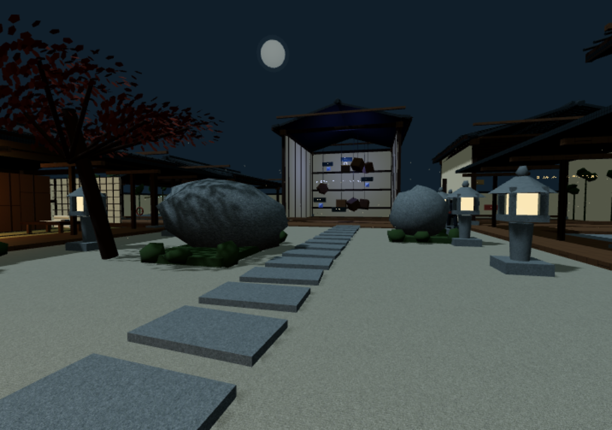
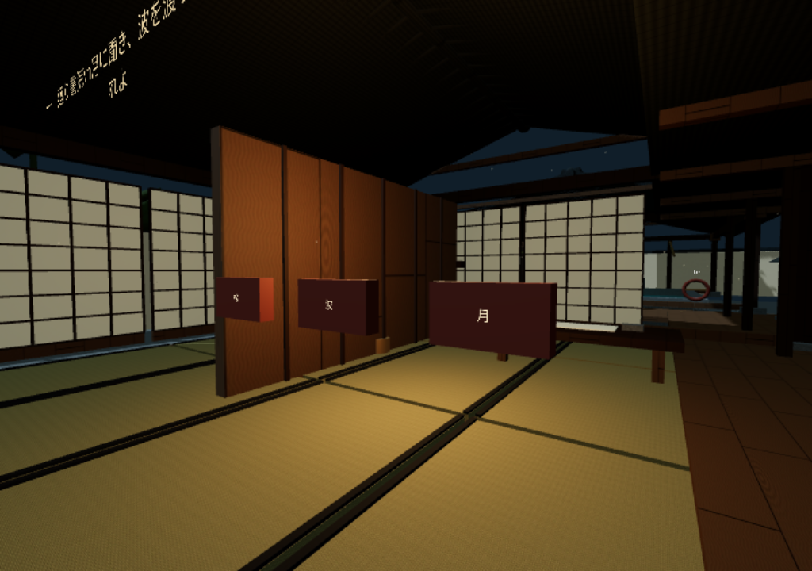
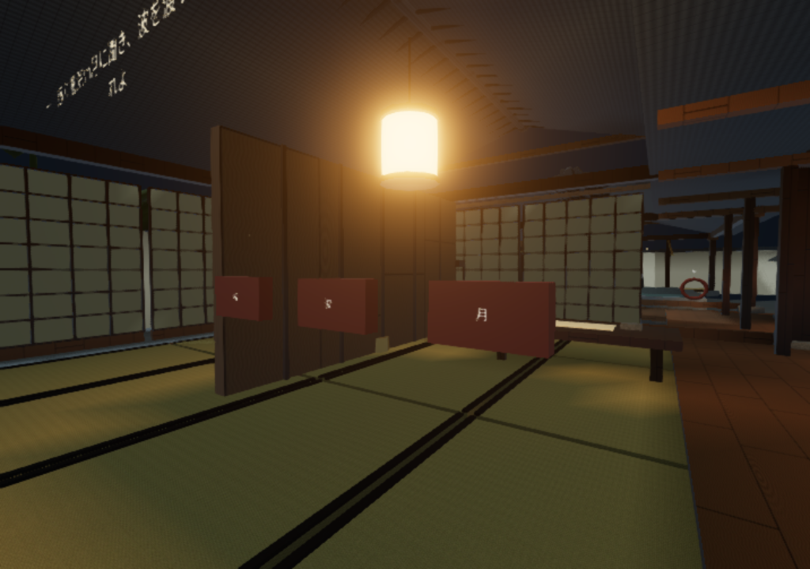

# v1.1 映像とベイク

「映像」からグローの標準／軽量／切と0〜55%の強度、細部の陰影と灯りを調整できます。これは個人の表示設定で、共有ゲーム状態や難易度を変えません。

## 保存したベイクの範囲

`src/geometry.ts` の同じ実メッシュを描画とオフライン計算の双方に使います。床と障子は光の補間用に分割し、素材単位のバッチは維持しています。

- **局所AO**：頂点位置と法線から24本の決定的なコサイン分布の半球方向へ光線を飛ばし、2.4m以内の遮蔽を距離で重み付けします。実三角形にBVHで交差判定し、表面から0.025mのバイアスで自己交差を抑えます。描画時のAO混合は80%。
- **静的灯籠の直接拡散光**：15灯の位置への可視性、距離減衰、受光面の余弦を計算し、頂点のRGBへ保存します。相対照度の表現であり、実測ルーメンによる校正ではありません。
- RGBA8のRGBは拡散光、AはAO可視度。`public/lighting/architecture.rgba` **933,732 bytes**、80,934点、**1,985,158 rays**。入力形状・生成スクリプト・出力のSHA-256と範囲は `src/bake-meta.json` と配布される `lighting/bake-report.json` に記録します。

これは**頂点AO＋静的な直接拡散光のベイク**です。多重反射GI、シーン全体の間接光ライトマップ、動く忍者・プレイヤー・回転扉・水面のベイクではありません。これらは通常の動的照明で描画します。

## 再生成

```sh
npm ci
npm run bake
npm run check:bake
npm run build:pages
```

`check:bake` は実形状とスクリプトのハッシュ、バイナリの長さとSHAを照合し、不一致ならビルドを停止します。ベイクはNode.js＋Three.js＋three-mesh-bvh 0.8.3で実行し、外部サービス・GPU・有料素材は不要です。固定サンプル順で生成し、日時を出力へ埋め込まないため同じ入力で再生成できます。

## 光と素材

木・漆・瓦は粗さとクリアコートを個別調整し、真鍮の金属反射、石・畳の法線／粗さマップを使用します。自作の月夜の放射輝度分布をPMREMで一度だけフィルタし、PBRの反射環境に使います。外部HDR写真は使用していません。リアルタイムの月光と空の環境光、保存された灯籠の拡散光を組み合わせます。

標準はHDR閾値付きUnrealBloomPass（threshold 1.15、strength 0〜0.55、初期0.28）と出力後のFXAA。画面全体の明部を対象とし、HUDはHTMLなので滲ませません。軽量は灯籠15個の放射状ハローを1 drawで描画し、追加の画面処理を省きます。携帯端末・低いrenderScale・浮動小数点描画非対応では軽量へ移行。XR中はBloomとHaloをOFFにします。反射環境はデスクトップかつ描画倍率0.6超、浮動小数点描画対応時のみ生成。低倍率ではクリアコートも省き、色・法線・粗さ・保存ベイクを保った標準PBRで描画します。

## ブラウザ検証と比較

`npm run preview:pages` の起動後、`BROWSER=/usr/bin/chromium npm run test:lighting`。標準／軽量／切、強度0、上限55%、陰影OFF／ONを実際のUI操作で確認します。変更前後は1024×720、high、renderScale 0.7、影ON、同じ視点。ソフトウェアGPUでの値を実GPUやVR性能に換算しません。低負荷の4タブ同期試験と単画面の映像試験を分離しています。

| v1.0.1 | v1.1 |
|---|---|
|  |  |
|  |  |

VR実機、実Android、公開URLでの3D通し確認は従来の制約が残っています。公開URLへの接続制限や親側WebGL無効を解消したとは扱いません。

上の比較はコミット前のローカル実画面です。リリース通知用には最終コミットをCIでビルドして撮り直した中庭・書院・HUD付きプレイ画面を添付します。`SCREENSHOTS.json` に版・コミット・撮影条件・画像SHAを記録し、対応しないビルドの画像では配布を作れません。
